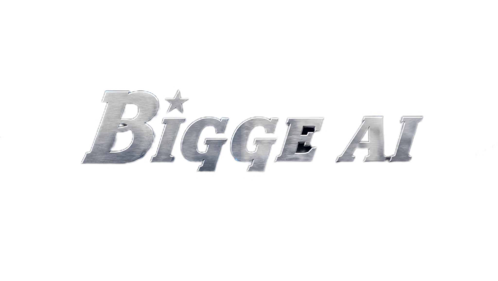

## Hey, this is Bigge AI 👋

We are the **Department of AI Engineering** at [Bigge Crane and Rigging](https://www.bigge.com) — a company that started out hauling freight in **1916**, dragged girders to the Golden Gate Bridge in **1935**, and today runs **1,000+ cranes** out of **20+ locations** under the fourth generation of the same family. 🏗️

We are the ones who write the software. Our first commit landed **May 6th, 2026**. Since then we have stood up **17 repositories**, an internal AI operating system, **67** governed tools over the company's systems of record, an automation factory, and a monthly brief that goes out to the whole company. The department holds itself to a hard cap of **four builds in active development** against **19 initiatives** on the books, because the fastest way to ship nothing is to start everything. 🪝

**Built for a billion.**

### 🏗️ What we're building

Everything here is built for Bigge — its employees, its fleet, and its customers. Nothing is for sale.

- [**bigge-os**](https://github.com/Bigge-AI/bigge-os) — Where an idea becomes shipped work. Anyone submits a problem, it gets triaged, approved ones become projects, and measured results land on **the Wall**. ~**72k** lines of TypeScript, **618** passing tests, **26** question intents, **2** agents. 🧠
- [**workpro-mcp-monorepo**](https://github.com/Bigge-AI/workpro-mcp-monorepo) — Three MCP servers that hand an AI assistant real fleet, operations, and field-service data: **29 + 21 + 17 = 67 tools**, overwhelmingly reads, and every write labeled as one in the catalog. 🔌
- [**partspro**](https://github.com/Bigge-AI/partspro) — A shop mechanic types an equipment number and gets the right exploded diagram, serial breaks and all. Went from one **8.6 MB** catalog file to a **~2 KB** index. 🔧
- [**BiggeAINewsletter**](https://github.com/Bigge-AI/BiggeAINewsletter) — The monthly brief, live at [news.bigge.ai](https://news.bigge.ai). Issue 01 shipped **14 articles** and about **52 minutes** of reading. 📰
- [**bigge-ai-landing**](https://github.com/Bigge-AI/bigge-ai-landing) — The department's front door, plus the internal docs behind it. 🚪

### 🧠 How we work

We use a **forward-deployed engineering model**: `Embed → Deliver → Enable → Rotate`. Our engineers sit with the people who will use the thing, ship it into production, hand over ownership, and rotate out. We build alongside the people who use our software, not in isolation.

Four pillars govern the work — **Visibility**, **Excellence**, **Accountability**, **Ownership**. In practice that cashes out as a handful of opinions we will happily defend:

- **Diagnose before we build.** Low crane utilization could be demand, availability, pricing, the market, a process, or plain customer visibility. One of those needs a tool. Guess which one and you have a 20% chance.
- **Prove the boring part first.** 🥱 *"Inside this team, calling a system boring is praise. Boring means nobody thinks about it."*
- **No tickets.** *"The ticket queue is where adoption goes to die."* A shipped tool nobody uses costs more than the wait would have.
- **A dashboard number is not a decision.** It tells you where to look. It never tells you what to do.
- **Own the harness, rent the model.** *"Bigge owns the harness; the model underneath is dealer's choice."* Our advantage is the capability, not the vendor.
- **Sometimes the best AI solution is no AI at all.** 🤷 Yes, that is in print, from the Director, where the team can screenshot it.

And because these agents touch systems that dispatch real cranes, every single tool call goes through a **Gatekeeper** that classifies it as `observe` (read, runs now), `act` (write, waits for a human), or `deny` (not today). Deletion is something you go do in the source system, on purpose, signed in as yourself. 🔒

### 🔩 What it runs on

Next.js 16, React 19, and TypeScript up front. Postgres with pgvector and Drizzle underneath. [MCP](https://modelcontextprotocol.io) everywhere in between, [eve](https://github.com/vercel/eve) for the agents, Langfuse for tracing, and Vercel, Azure, and Cloudflare holding it all up.

Also: a **Mac mini** sitting on a desk in our office, quietly serving open models over a Cloudflare tunnel. 🖥️ *"Once you ignore the cost of the computer and the electricity keeping it on, every token it generates costs us exactly zero dollars."*

### 👓 Appendix

The department is up and **the queue is open**. If there is something in your part of Bigge that belongs on it, send it — [`kchiasson@bigge.com`](mailto:kchiasson@bigge.com) — and read [news.bigge.ai](https://news.bigge.ai) to see what came of the last batch. 🙇‍♂️

We are also always looking for engineers who want to build AI systems for cranes, dirt, and steel instead of another dashboard. 🙌

	
"Tell me more, I can't get enough!"

	 
	<ul>
		<li>We do not publish fabricated metrics. There is a comment in our landing page source where a template's "100+ companies served" section used to be, explaining exactly why it was deleted. Every number on this page traces to a file, a commit log, or a published article. 📏</li>
		<li>We contribute to and self-host the tools we depend on, including <a href="https://github.com/Bigge-AI/langfuse">Langfuse</a>, a fork of <a href="https://github.com/Bigge-AI/hermes-webui">Hermes WebUI</a>, and a fork of <a href="https://github.com/Bigge-AI/ms-365-mcp-server">ms-365-mcp-server</a> that reaches <b>311</b> Microsoft Graph endpoints. 🦦</li>
		<li><a href="https://github.com/Bigge-AI/smartsheet-crawler-carl">Carl</a> crawls our Smartsheet estate and draws the dependency graph — six kinds of edge, <b>10,000+</b> nodes, rendered like an Unreal reference viewer. Turns out the spreadsheets had opinions about each other. 🕸️</li>
		<li>Our domain model knows seven crane family codes by heart: <code>CCC</code>, <code>TCC</code>, <code>RTC</code>, <code>ATC</code>, <code>HTC</code>, <code>TOW</code>, and <code>FLT</code>. Ask us about lattice boom crawlers sometime. 🏗️</li>
		<li>The standard for whether a commitment is real, per one of our operations leaders: <i>"if it is not in WorkPro and there is no blue box, it is not true."</i> We built to that standard. 🟦</li>
		<li>Utilization is the north star metric for the fleet. Nearly everything we build is eventually arguing with that number. ⭐</li>
	</ul>

---

🤫 Psst! Most of what you see here is private. If you work at Bigge and a link 404s, ask for an invite to the org.

<!--
The real world always wins.
🏗️⛓️⬇️
-->
